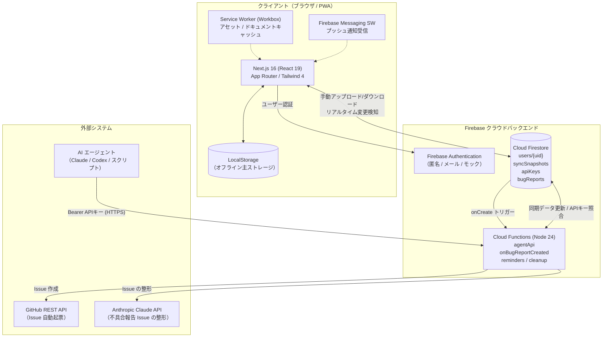
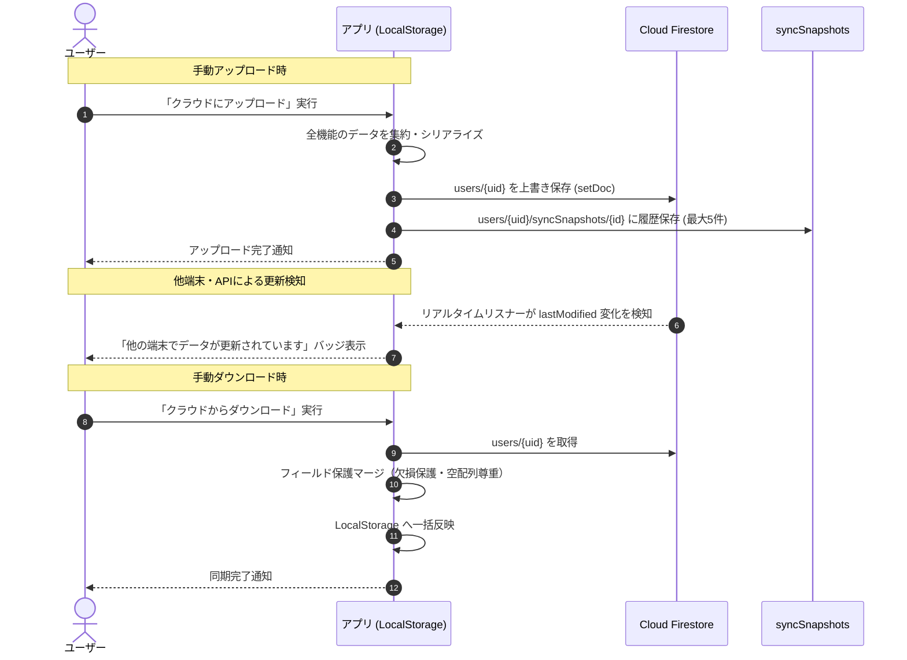

# システムアーキテクチャ設計書

本ドキュメントは、デイリールーティン管理アプリ全体のシステム構成、データフロー、オフライン同期モデル、およびセキュリティ設計を解説するアーキテクチャ設計書です。

---

## 1. システム全体構成

本アプリは、ブラウザ側で完結する**オフラインファーストなクライアントアーキテクチャ**を中心に、Firebase バックエンド（Authentication, Firestore, Cloud Functions）および AI エージェント API、GitHub API 連携が協調して動作します。



---

## 2. オフラインファースト & 同期モデル

### 2-1. データアクセスの基本原則

- **一次データソースは LocalStorage**:
  すべての機能（ルーティン、家計簿、ジャーナル、Todo、運動記録等）は、まず端末の LocalStorage を読み書きします。ネットワークが切断されている環境でも全機能が完全に利用可能です。
- **ユーザーごとのスコープ分離**:
  LocalStorage キーは `user:<uid>:<key>`（または未ログイン時のフォールバックキー / 共通設定キー）として管理され、同一ブラウザ上でのマルチアカウント利用時にもデータが混ざりません。ログイン時には未スコープの既存データから `user:<uid>:<key>` への自動移行（`migrateToUserStorage`）が実行されます。移行するのは `src/lib/storage/core-modules/userScope.ts` の `USER_DATA_KEYS` に並べた 12 個のキー（ルーティン・進捗・履歴・設定・ポモドーロ・作業記録・家計簿の旧データ・食事・日記・体重・プリセット）だけです。Todo リスト・Todo カテゴリ・運動記録・家計簿の項目とカテゴリなど、後から追加された機能のキーは含まれていないため、ログイン前にそれらを保存していた場合は、ログイン後のユーザー別キーへ引き継がれません。

### 2-2. クラウド同期フロー



### 2-3. データ保護・下位互換性設計

API や旧バージョンのアプリ、新機能追加時のデータ衝突を防ぐため、以下のデータ保護設計が組み込まれています。

1. **欠損フィールドの維持**:
   リモートの同期データに特定フィールド（例: 新機能の `workoutExercises`）が存在しない場合、ローカルに存在する既存データを消さずに維持します。
2. **明示的な空配列の尊重**:
   ユーザーが意図して全アイテムを削除した場合（配列の長さが 0）、欠損とは区別して空配列として正しく同期・反映します。
3. **当日進捗の保護 (`dailyProgress`)**:
   当日のチェック状況は null で上書きされないよう保護し、チェック状態の意図しないリセットを防ぎます。
4. **自動スナップショット保持**:
   アップロードおよび API による変更が行われるたびに、`syncSnapshots` コレクションに直近最大 5 件の履歴が自動保持され、設定画面からいつでも過去の状態へワンクリック復元できます。

### 2-4. クライアント耐障害性（ストレージ書き込み失敗の検知と復旧）

LocalStorage の容量制限（QuotaExceededError）やブラウザのプライベートモード等の保存障害に対し、サイレント障害を防ぐフェイルセーフ設計を採用しています。

- **イベント駆動通知**: ストレージモジュールが保存失敗時に `storage-write-failed` イベントを発火。
- **UI 表示 (`StorageWriteFailureBanner`)**: ヘッダー操作を邪魔しない画面下部（`fixed bottom-0`）に警告を表示し、不要な記録の削除や設定変更を案内。
- **再入防止 & 再送機構**: リスナー内の書き込み失敗ループを防ぐ再入ガードと、初回マウント時の取りこぼしを防ぐ再送キャッシュを実装。
- **イベントの型**: `storage-write-failed`（`storageWriteFailureEvent.ts`）と同期状態の `sync-status-changed`（`src/features/sync/sync/statusStore.ts`）は、発火する側のモジュールで `WindowEventMap` に `CustomEvent<…>` の型を宣言しています。`window.addEventListener` のリスナーは `detail` の型をキャストなしで受け取れます。

### 2-5. 日時・タイムゾーン処理とデータマイグレーション基盤

習慣管理・日次記録において日付のズレは重大なデータ不整合となるため、以下の原則を徹底しています。

- **日本標準時（JST / Asia/Tokyo）への統一**:
  クライアントの履歴キー（`daily-history`, `weight-history`, `meal-history` 等）および Cloud Functions（毎分通知・午前0時クリーンアップ）はすべて JST 基準で一貫して算出・判定されます。
- **マイグレーション基盤 (`runOncePerUser`)**:
  過去のバージョンで UTC 基準で保存されていた日付キーを JST へ自動補正する処理（`migrateDateKeys`）を、ユーザーごとに初回ログイン時のみ安全に 1 度だけ実行するマーカー管理を実装しています。

---

## 3. レイヤードアーキテクチャ & ディレクトリ責務

フロントエンドは単一責任の原則（SRP）と ViewModel パターンに基づき、疎結合に設計されています。

### 3-1. 責務の分類

| レイヤー           | ディレクトリ                | 役割と責務                                                                                                                                                                                                                                                                                                                                                  |
| :----------------- | :-------------------------- | :---------------------------------------------------------------------------------------------------------------------------------------------------------------------------------------------------------------------------------------------------------------------------------------------------------------------------------------------------------- |
| **App**            | `src/app/`                  | URL パスとルーティングのエントリーポイント。画面の組み立てのみを行いロジックを持たない。                                                                                                                                                                                                                                                                    |
| **Layouts**        | `src/layouts/`              | ヘッダー・ナビゲーション・サイドバーなど、ページをまたぐ外殻の配置。                                                                                                                                                                                                                                                                                        |
| **Features**       | `src/features/{feature}/`   | ドメインごとのビジネスロジック、状態管理フック、UI、ストレージ操作を凝集（Co-location）。                                                                                                                                                                                                                                                                   |
| **Components**     | `src/components/`           | ドメイン知識を持たない汎用 UI 部品（`CardPanel`, `ToggleSwitch`, `ProgressBar`, `LoadingIndicator`, `ErrorAlert`, `FieldGroup`, `LabeledField`, `PeriodNavButton` 等）と、ルートで使う `ClientProviders`・`RootErrorBoundary`・保存失敗バナー。                                                                                                             |
| **Hooks**          | `src/hooks/`                | 画面をまたいで使うフック。汎用 UI フック（`useCloseOnEscape`, `useLongPress`, `useBodyScrollLock`, `useDismissKeyboardOnSubmit`, `useFormOpenAutoFocus`, `useCategoryNameEditing`）と、ヘッダーのメニュー・同期操作、認証状態と同期の購読、ルーティン通知の予約、保存失敗の購読（`useStorageWriteFailure`）、PWA・Service Worker 登録、テーマ適用のフック。 |
| **Lib**            | `src/lib/`                  | Firebase の初期化と Auth/Firestore/Messaging の取得（`firebase-modules/`）、LocalStorage の読み書き基盤（`storage/`）、祝日判定、日付キーの移行、IME 判定などの共通処理。                                                                                                                                                                                   |
| **Services**       | `src/services/`             | 認証サービス（`authService.ts`）とローカル擬似認証（`localAuthService.ts`）。                                                                                                                                                                                                                                                                               |
| **Config / Types** | `src/config/`, `src/types/` | アプリ設定の定数と、ルーティンなど複数機能で共有する型定義。                                                                                                                                                                                                                                                                                                |

> 注意: コーディング規約（[coding-standards.md](./coding-standards.md)）では components と hooks は features を参照しないことになっていますが、現状は `src/hooks/` のヘッダー・認証同期・通知関連のフックと `src/components/AuthGuard.tsx` が `@/features/*` を参照しています。また、`src/lib/` は規約の依存ルールに挙がっていませんが、`src/lib/storage/exports/*.ts`（各機能の `storage.ts` の再公開）と `src/lib/dateKeyMigration.ts` が `@/features/*` を参照しています。

### 3-2. Feature ディレクトリの内部構成

各 feature ディレクトリは以下のように責務を分離しています：

```
src/features/{feature-name}/
├── components/          # この機能専用のプレゼンテーショナルコンポーネント
├── locales/
│   └── ja.json          # 日本語テキスト定数（ViewModel パターン）
├── helpers.ts           # 状態を持たない純粋な計算・フォーマット関数
├── storage*.ts          # LocalStorage への読み書き操作
├── use*State.ts         # 状態管理・副作用・ユーザー操作のカスタムフック
├── types.ts             # ドメインモデル・インターフェース定義
└── index.ts             # 外部に公開する公開インターフェース
```

### 3-3. SPA 画面切り替えと動的コード分割

本アプリはルートページ（`src/app/page.tsx`）が起点となり、`PageLayout` および `pageComponentResolver.ts` により `PageType`（全24画面）を切り替える SPA アーキテクチャを採用しています。

- **動的インポート (`next/dynamic`)**: 各機能ページ（`BudgetPage`, `JournalPage`, `WorkoutTrackerPage` 等）は `lazyPageComponents.ts` で遅延読み込みされ、初期バンドルサイズを大幅に削減。
- **ナビゲーションと履歴管理**: 画面遷移は React の状態（`currentPage`）と `NavigationContext` 経由で伝播し、最後に開いた画面は LocalStorage の `currentPage` キーに永続化されてリロード時にも復元されます。

### 3-4. 共通基盤モジュール（`src/lib/`）

**Firebase（`src/lib/firebase-modules/`、公開窓口は `src/lib/firebase.ts`）**

| ファイル        | 役割                                                                                                                                                         |
| :-------------- | :----------------------------------------------------------------------------------------------------------------------------------------------------------- |
| `config.ts`     | 環境変数から Firebase の設定を作る。API キー・プロジェクト ID・アプリ ID がそろったときだけ `isFirebaseConfigured` が true になる。                          |
| `initialize.ts` | 設定済みなら App を初期化する（既にあれば再利用）。ブラウザでは Firestore と Auth も初期化し、Messaging は対応ブラウザでだけ非同期に初期化する。             |
| `state.ts`      | 初期化した App・Auth・Firestore・Messaging を保持する。                                                                                                      |
| `auth.ts`       | `getOrCreateUser`（ログイン中のユーザー、いなければ匿名ログイン）と `getAuthInstance`。設定不足・未初期化・サーバー側での呼び出しは `FirebaseError` にする。 |
| `firestore.ts`  | `getFirestoreInstance`。未初期化なら `FirebaseError`（`firestore-not-available`）。                                                                          |
| `messaging.ts`  | FCM トークンの取得とフォアグラウンド通知の購読。                                                                                                             |

**LocalStorage 基盤（`src/lib/storage/core-modules/`）**

| ファイル                      | 役割                                                                                                                                         |
| :---------------------------- | :------------------------------------------------------------------------------------------------------------------------------------------- |
| `userScope.ts`                | ログイン中のユーザーごとにキーを分ける（`user:{uid}:{key}`）。ログイン前のデータをユーザー別のキーへ 1 度だけ移す（対象キーは 2-1 節）。     |
| `storageWrite.ts`             | `runStorageWrite`。書き込みの例外を投げずに保存失敗の通知へ変える（2-4 節）。                                                                |
| `storageWriteFailureEvent.ts` | 保存失敗を `storage-write-failed` イベントで通知する。リスナーが張られる前の失敗は直近 1 件を保持して再送する。                              |
| `localDataUpdatedAt.ts`       | ローカルデータの最終更新時刻を保存・取得する。保存時に `local-data-updated-at-changed` イベントを出し、読み取れない値や例外は 0 として扱う。 |

サーバー側（`window` が無い環境）では、Firebase は App だけを初期化し、Auth・Firestore の取得は `FirebaseError` になります。LocalStorage 基盤は読み書きせずに終わります（`runStorageWrite` は false、`getLocalDataUpdatedAt` は 0 を返す）。

### 3-5. 責務ごとに分けたモジュール

公開している関数の名前・引数・戻り値はそのままにして、中身を責務ごとのファイルに分けたモジュールです。呼び出し側は原則として公開窓口のファイルから import します（ルーティンの移行関数は下の表のとおり直接 import します）。

**認証サービス（`src/services/`、公開窓口は `authService.ts`）**

| ファイル              | 役割                                                                                                                                                                                                                                                                                                                  |
| :-------------------- | :-------------------------------------------------------------------------------------------------------------------------------------------------------------------------------------------------------------------------------------------------------------------------------------------------------------------- |
| `authService.ts`      | ログイン・サインアップ・ログアウト・匿名ログイン・テストアカウントでのログイン。Firebase が未設定なら、メール系は「Firebase 未設定」、匿名・テストアカウントは「クラウド機能未設定」の文言でエラーにする。テストアカウントが無いとき（`auth/user-not-found` / `auth/invalid-credential`）は作成してからログインする。 |
| `localAuthService.ts` | 開発用のローカル擬似認証。Firebase 未設定かつローカル認証が有効なとき（`shouldUseLocalAuth`）だけ使う。メールアドレスから uid（`local-user-…` / `local-test-…` / `local-anonymous`）を作り、`local-dev-auth-user` に保存する。`getLocalAuthUser` と `subscribeLocalAuthUser` は `authService.ts` から再公開している。 |

**同期スナップショット（`src/features/sync/sync/`、公開窓口は `snapshots.ts`）**

| ファイル                | 役割                                                                                                                                                                                                                      |
| :---------------------- | :------------------------------------------------------------------------------------------------------------------------------------------------------------------------------------------------------------------------ |
| `snapshots.ts`          | 履歴の保存（最大 5 件を超える古いものは削除）・一覧・復元・削除の手順。最新の履歴を削除したときは、次に新しい履歴を最新の同期データ `users/{uid}` にする（次が無ければ `users/{uid}` も削除する）。                       |
| `snapshotStore.ts`      | Firestore の読み書きだけを行う。履歴 `users/{uid}/syncSnapshots/{id}` の一覧（新しい順）・1 件取得・追加・削除と、最新の同期データ `users/{uid}` の上書き・削除。                                                         |
| `snapshotTaskStatus.ts` | `runSnapshotTask`。操作の間は同期中の状態にし、成功したら同期中を解除（復元では変更ありの表示も解除）、失敗したらエラー文言を同期状態に残して操作ごとのコード（`snapshot-list-failed` など）の `FirebaseError` を投げる。 |

**ルーティンのグループ修復（`src/features/routine/hooks/`、修復の入口は `routineGroupRepairModel.ts`）**

起動時の初期化（`routineLifecycleState.ts`）で、保存済みのルーティンを「曜日ごとに 1 件、同じ設定のものは `groupId` でまとめる」形に整えます。

| ファイル                           | 役割                                                                                                                                                                                                                                                                     |
| :--------------------------------- | :----------------------------------------------------------------------------------------------------------------------------------------------------------------------------------------------------------------------------------------------------------------------- |
| `routineGroupRepairModel.ts`       | `repairCorruptedGroupRoutines` と、`groupId` ごとにまとめる `groupRoutinesByGroupId`。汚染されたグループが 1 つでもあれば全グループを作り直し、全体の `sortOrder` を振り直す。汚染が無ければ受け取った配列をそのまま返す（呼び出し側は参照の比較で保存の要否を決める）。 |
| `routineGroupMultiDayMigration.ts` | `migrateMultiDayRoutinesWithGroup`。1 件で複数曜日を持つ旧形式を曜日ごとに分ける（`routineLifecycleState.ts` が直接 import する）。                                                                                                                                      |
| `routineGroupCorruption.ts`        | 汚染の判定（複数曜日を持つメンバーがいる、または同じ曜日のメンバーが重複している）。                                                                                                                                                                                     |
| `routineGroupDayRepair.ts`         | 1 グループを曜日ごとに 1 件へ作り直す。今日完了済みのメンバーを優先して残し、空いた曜日には複数曜日メンバーの id と作成日時を再利用する。足りなければ新しい id で作る。                                                                                                  |

`sortOrder` が同じときに id の昇順で並べる比較関数 `compareBySortOrderThenId` は `routineOrderModel.ts` にあります。

---

## 4. AI エージェント API アーキテクチャ

AI エージェント（Claude / Codex / スクリプト）から家計簿・ジャーナル・Todo・運動記録を直接操作するための専用 REST API 基盤です。

### 4-1. 認証と認可

- アプリの設定画面で発行した API キーで認証する。
- 平文キーは保存せず、ハッシュ照合で紐づくアカウントの同期データだけを読み書きする（他ユーザーのデータにはアクセスできない）。
- 操作手順・リクエスト形式の詳細は公開リポジトリの対象外（実装は `firebase-functions/src/agentApi/`）。

### 4-2. エージェント API の処理フロー（概要）

1. HTTPS で `agentApi` を呼び出す
2. API キーを検証し、紐づく uid を解決する
3. ルーティングと入力検証のあと、当該ユーザーの同期データを更新する
4. 必要に応じて同期スナップショットを残して応答する

---

## 5. セキュリティモデル

### 5-1. Firestore セキュリティルール (`firestore.rules`)

- **`users/{userId}`**:
  認証済みユーザー本人のみ読み書き可能（`request.auth.uid == userId`）。
- **`bugReports/{reportId}`**:
  認証済みユーザーであれば新規作成（`create`）可能。ただし `status == "pending"`, 必須フィールドの存在、文字数制限、`createdAt == request.time`（serverTimestamp）の改ざん防止ルールを強制。更新・削除はクライアントから一切禁止（Cloud Functions のみ書き換え可能）。
- **`apiKeys/{keyHash}`**:
  自身の `uid` に紐づくキーのみ `create`, `delete`, `read` 可能。第三者のキーの読み書きや UID 偽装は拒否。

### 5-2. 秘密情報の管理

- **Firebase Functions Secrets**:
  GitHub REST API 呼び出しに必要な `GITHUB_TOKEN` は Secret Manager で管理します。不具合報告の Issue を Claude で整形するための Anthropic API キー `ANTHROPIC_API_KEY` も Secret Manager で管理します（整形を使わない場合は値に `none` を登録）。対象リポジトリ名 `GITHUB_REPO` は `defineString` の通常パラメータで、Functions の `.env.<project-id>` に設定します。未指定時は `poteto317/daily-routine` を使用します。
- **FCM Service Worker 自動生成**:
  Firebase 設定情報を公開リポジトリに残さないため、ビルド時に `.env.local` から `tools/generate-firebase-messaging-sw.mjs` を通じて動的生成されます。

---

## 📖 関連ドキュメント

- [実装機能リファレンス](../04-reference/features.md)
- [コーディング規約](./coding-standards.md)
- [レビュー教訓集](./review-lessons.md)
- [GitHub Actions CI/CD ガイド](./github-actions-guide.md)
- [クラウド同期セットアップ](../01-getting-started/SYNC_SETUP.md)
