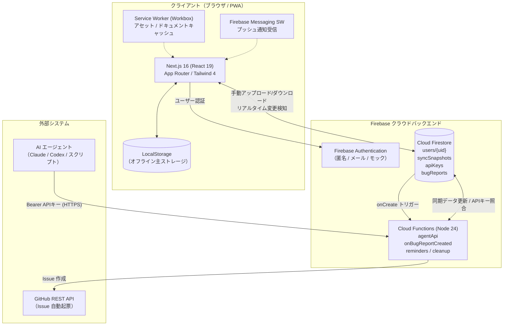
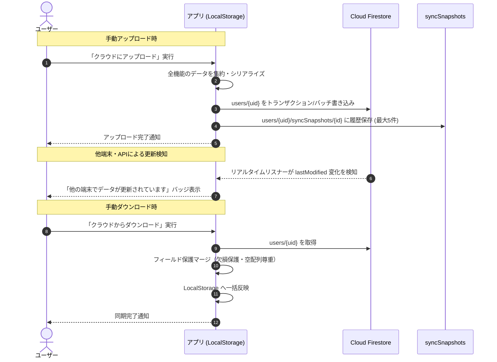
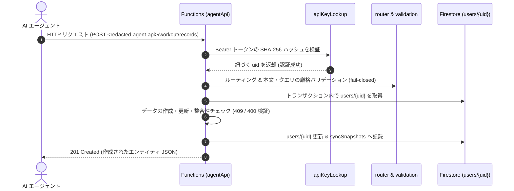

# システムアーキテクチャ設計書

本ドキュメントは、デイリールーティン管理アプリ全体のシステム構成、データフロー、オフライン同期モデル、およびセキュリティ設計を解説するアーキテクチャ設計書です。

---

## 1. システム全体構成

本アプリは、ブラウザ側で完結する**オフラインファーストなクライアントアーキテクチャ**を中心に、Firebase バックエンド（Authentication, Firestore, Cloud Functions）および AI エージェント API、GitHub API 連携が協調して動作します。



---

## 2. オフラインファースト & 同期モデル

### 2-1. データアクセスの基本原則

- **一次データソースは LocalStorage**:
  すべての機能（ルーティン、家計簿、ジャーナル、Todo、運動記録等）は、まず端末の LocalStorage を読み書きします。ネットワークが切断されている環境でも全機能が完全に利用可能です。
- **ユーザーごとのスコープ分離**:
  LocalStorage キーは `user:<uid>:<key>`（または未ログイン時のフォールバックキー / 共通設定キー）として管理され、同一ブラウザ上でのマルチアカウント利用時にもデータが混ざりません。ログイン時には未スコープの既存データから `user:<uid>:<key>` への自動移行（`migrateToUserStorage`）が実行されます。

### 2-2. クラウド同期フロー



### 2-3. データ保護・下位互換性設計

API や旧バージョンのアプリ、新機能追加時のデータ衝突を防ぐため、以下のデータ保護設計が組み込まれています。

1. **欠損フィールドの維持**:
   リモートの同期データに特定フィールド（例: 新機能の `workoutExercises`）が存在しない場合、ローカルに存在する既存データを消さずに維持します。
2. **明示的な空配列の尊重**:
   ユーザーが意図して全アイテムを削除した場合（配列の長さが 0）、欠損とは区別して空配列として正しく同期・反映します。
3. **当日進捗の保護 (`dailyProgress`)**:
   当日のチェック状況は null で上書きされないよう保護し、チェック状態の意図しないリセットを防ぎます。
4. **自動スナップショット保持**:
   アップロードおよび API による変更が行われるたびに、`syncSnapshots` コレクションに直近最大 5 件の履歴が自動保持され、設定画面からいつでも過去の状態へワンクリック復元できます。

### 2-4. クライアント耐障害性（ストレージ書き込み失敗の検知と復旧）

LocalStorage の容量制限（QuotaExceededError）やブラウザのプライベートモード等の保存障害に対し、サイレント障害を防ぐフェイルセーフ設計を採用しています。

- **イベント駆動通知**: ストレージモジュールが保存失敗時に `storage-write-failed` イベントを発火。
- **UI 表示 (`StorageWriteFailureBanner`)**: ヘッダー操作を邪魔しない画面下部（`fixed bottom-0`）に警告を表示し、不要な記録の削除や設定変更を案内。
- **再入防止 & 再送機構**: リスナー内の書き込み失敗ループを防ぐ再入ガードと、初回マウント時の取りこぼしを防ぐ再送キャッシュを実装。

### 2-5. 日時・タイムゾーン処理とデータマイグレーション基盤

習慣管理・日次記録において日付のズレは重大なデータ不整合となるため、以下の原則を徹底しています。

- **日本標準時（JST / Asia/Tokyo）への統一**:
  クライアントの履歴キー（`daily-history`, `weight-history`, `meal-history` 等）および Cloud Functions（毎分通知・午前0時クリーンアップ）はすべて JST 基準で一貫して算出・判定されます。
- **マイグレーション基盤 (`runOncePerUser`)**:
  過去のバージョンで UTC 基準で保存されていた日付キーを JST へ自動補正する処理（`migrateDateKeys`）を、ユーザーごとに初回ログイン時のみ安全に 1 度だけ実行するマーカー管理を実装しています。

---

## 3. レイヤードアーキテクチャ & ディレクトリ責務

フロントエンドは単一責任の原則（SRP）と ViewModel パターンに基づき、疎結合に設計されています。

### 3-1. 責務の分類

| レイヤー       | ディレクトリ              | 役割と責務                                                                                |
| :------------- | :------------------------ | :---------------------------------------------------------------------------------------- |
| **App**        | `src/app/`                | URL パスとルーティングのエントリーポイント。画面の組み立てのみを行いロジックを持たない。  |
| **Layouts**    | `src/layouts/`            | ヘッダー・ナビゲーション・サイドバーなど、ページをまたぐ外殻の配置。                      |
| **Features**   | `src/features/{feature}/` | ドメインごとのビジネスロジック、状態管理フック、UI、ストレージ操作を凝集（Co-location）。 |
| **Components** | `src/components/`         | ドメイン知識を持たないピュアな汎用UI部品（Button, Input, Card, Modal等）。                |
| **Hooks**      | `src/hooks/`              | ドメイン知識を持たない共通ユーティリティフック（useWindowSize, useDebounce等）。          |
| **Utils**      | `src/utils/`              | 純粋な計算、フォーマット、日時処理ユーティリティ。                                        |

### 3-2. Feature ディレクトリの内部構成

各 feature ディレクトリは以下のように責務を分離しています：

```
src/features/{feature-name}/
├── components/          # この機能専用のプレゼンテーショナルコンポーネント
├── locales/
│   └── ja.json          # 日本語テキスト定数（ViewModel パターン）
├── helpers.ts           # 状態を持たない純粋な計算・フォーマット関数
├── storage*.ts          # LocalStorage への読み書き操作
├── use*State.ts         # 状態管理・副作用・ユーザー操作のカスタムフック
├── types.ts             # ドメインモデル・インターフェース定義
└── index.ts             # 外部に公開する公開インターフェース
```

### 3-3. SPA 画面切り替えと動的コード分割

本アプリはルートページ（`src/app/page.tsx`）が起点となり、`PageLayout` および `pageComponentResolver.ts` により `PageType`（全23画面）を切り替える SPA アーキテクチャを採用しています。

- **動的インポート (`next/dynamic`)**: 各機能ページ（`BudgetPage`, `JournalPage`, `WorkoutTrackerPage` 等）は `lazyPageComponents.ts` で遅延読み込みされ、初期バンドルサイズを大幅に削減。
- **ナビゲーションと履歴管理**: 画面遷移は React の状態（`currentPage`）と `NavigationContext` 経由で伝播し、最後に開いた画面は LocalStorage の `currentPage` キーに永続化されてリロード時にも復元されます。

---

## 4. AI エージェント API アーキテクチャ

AI エージェント（Claude / Codex / スクリプト）から家計簿・ジャーナル・Todo・運動記録を直接操作するための専用 REST API 基盤です。

### 4-1. 認証と認可

- **トークン形式**: `Authorization: Bearer drk_<32バイト暗号乱数>`
- **ハッシュ検証**: トークン平文は一切保存せず、SHA-256 でハッシュ化した値を Firestore `apiKeys/{keyHash}` から検索。
- **アカウント分離**: キーに記録された `uid` をもとに、対応する `users/{uid}` の同期データのみを読み書き。他ユーザーのデータには一切アクセスできません。

### 4-2. エージェント API の処理フロー



---

## 5. セキュリティモデル

### 5-1. Firestore セキュリティルール (`firestore.rules`)

- **`users/{userId}`**:
  認証済みユーザー本人のみ読み書き可能（`request.auth.uid == userId`）。
- **`bugReports/{reportId}`**:
  認証済みユーザーであれば新規作成（`create`）可能。ただし `status == "pending"`, 必須フィールドの存在、文字数制限、`createdAt == request.time`（serverTimestamp）の改ざん防止ルールを強制。更新・削除はクライアントから一切禁止（Cloud Functions のみ書き換え可能）。
- **`apiKeys/{keyHash}`**:
  自身の `uid` に紐づくキーのみ `create`, `delete`, `read` 可能。第三者のキーの読み書きや UID 偽装は拒否。

### 5-2. 秘密情報の管理

- **Firebase Functions Secrets**:
  GitHub REST API 呼び出しに必要な `GITHUB_TOKEN` および対象リポジトリ名 `GITHUB_REPO` は、GCP Secret Manager で安全に管理され、コード内にはコミットされません。
- **FCM Service Worker 自動生成**:
  Firebase 設定情報を公開リポジトリに残さないため、ビルド時に `.env.local` から `tools/generate-firebase-messaging-sw.mjs` を通じて動的生成されます。

---

## 📖 関連ドキュメント

- [実装機能リファレンス](../04-reference/features.md)
- [AI エージェント向け API 仕様](../04-reference/agent-api.md)
- [コーディング規約](./coding-standards.md)
- [レビュー教訓集](./review-lessons.md)
- [GitHub Actions CI/CD ガイド](./github-actions-guide.md)
- [クラウド同期セットアップ](../01-getting-started/SYNC_SETUP.md)
